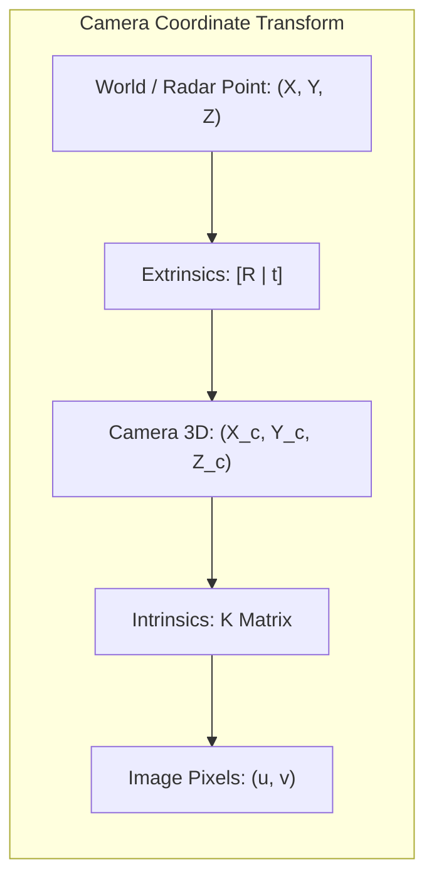
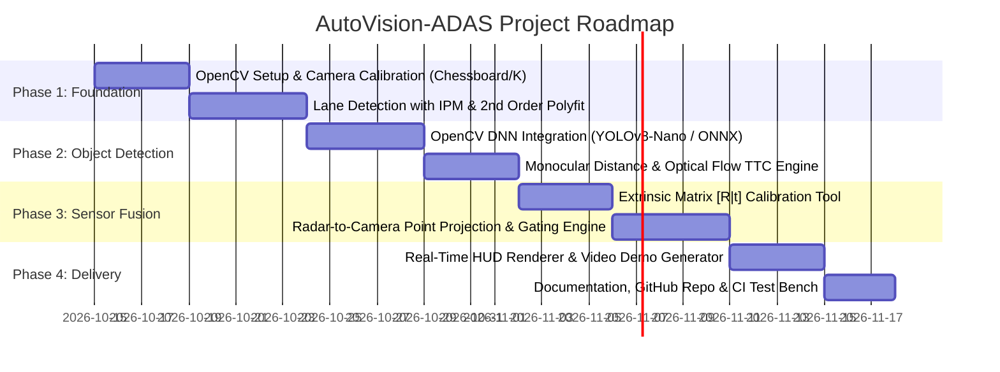

# AutoVision-ADAS: Real-Time Computer Vision & Camera-Radar Perception Stack for Autonomous Driving

| Metadata | Details |
| :--- | :--- |
| **Document ID** | `PROP-OPENCV-ADAS-001` |
| **File Name** | `OPENCV.md` |
| **Target Domain** | Automotive ADAS (SAE Level 2+ / Level 3 Perception) |
| **Technologies** | OpenCV 4.x (C++17 / Python 3.10), OpenCV DNN, Eigen3, CUDA / SIMD |
| **Complementary System** | InnoSenT 77 GHz FMCW Radar Multi-Target Tracker ([specification.md](file:///c:/Users/Mourad/Desktop/MOURADCV/InnoSent/specification.md)) |
| **Performance Target** | Real-time processing at $\ge 30\,\text{FPS}$ ($\le 33\,\text{ms}$ per frame) on 1080p automotive video streams |

---

## 1. Executive Summary & Project Vision

**AutoVision-ADAS** is an industrial-grade computer vision perception system designed for autonomous vehicles and advanced driver assistance systems (ADAS). Built on **OpenCV (C++ / Python)**, the system extracts critical environmental context from front-facing automotive cameras:
* **Road geometry & lane boundaries** (Lane Departure Warning - LDW)
* **Dynamic obstacles (vehicles, pedestrians, cyclists)** with 3D spatial bounding estimations
* **Ego-motion & Time-to-Collision (TTC)** calculation
* **Extrinsic Camera-Radar Sensor Fusion**, projecting 77 GHz radar point-clouds/tracks directly onto the camera image plane to overcome vision-only edge cases (poor lighting, fog, direct glare).

```
+=======================================================================================+
|                     AUTONOMOUS DRIVING VISION PIPELINE (OPENCV)                       |
|                                                                                       |
|   [Automotive Camera Stream: 1080p @ 30 FPS]                                          |
|                         |                                                             |
|                         v                                                             |
|   +-------------------------------------------------------------------------------+   |
|   | 1. PRE-PROCESSING & CALIBRATION                                               |   |
|   |    cv::undistort() -> Color Space Transform (HLS/LAB) -> CLAHE Contrast       |   |
|   +-------------------------------------------------------------------------------+   |
|            |                                              |                           |
|            v                                              v                           |
|   +-------------------------------+              +--------------------------------+   |
|   | 2. LANE GEOMETRY & CURVATURE  |              | 3. OBSTACLE PERCEPTION (DNN)   |   |
|   |    * Inverse Perspective Map  |              |    * cv::dnn::readNetFromONNX  |   |
|   |      (Bird's Eye View)        |              |    * YOLOv8-Nano / MobileNet   |   |
|   |    * Sliding Window Search    |              |    * 2D & Pseudo-3D Bounding   |   |
|   |    * 2nd-Order Polyfit        |              |    * Lucas-Kanade Optical Flow |   |
|   +-------------------------------+              +--------------------------------+   |
|            |                                              |                           |
|            +----------------------+-----------------------+                           |
|                                   |                                                   |
|                                   v                                                   |
|   +-------------------------------------------------------------------------------+   |
|   | 4. EXTENT & DISTANCE ESTIMATION                                               |   |
|   |    * Pinhole Camera Geometry (Z_est = f * H_real / h_pixels)                  |   |
|   |    * Optical Expansion TTC = Delta_t / (S_k / S_k-1 - 1)                      |   |
|   +-------------------------------------------------------------------------------+   |
|                                   |                                                   |
|                                   v                                                   |
|   +-------------------------------------------------------------------------------+   |
|   | 5. CAMERA-RADAR SPATIAL FUSION (Homography & Calibration Matrix)             |   |
|   |    * Ingest 77 GHz Radar Tracks (x, y, vx, vy) from InnoSenT EKF Tracker      |   |
|   |    * P_proj = K * [R | t] * X_radar                                           |   |
|   |    * IoU Bounding Box Association & Sensor State Fusion                       |   |
|   +-------------------------------------------------------------------------------+   |
|                                   |                                                   |
|                                   v                                                   |
|   +-------------------------------------------------------------------------------+   |
|   | 6. ADAS DECISION ENGINE & OVERLAY                                             |   |
|   |    * Forward Collision Warning (FCW) & AEB Trigger                            |   |
|   |    * Lane Departure Warning (LDW) & Vehicle Offset                            |   |
|   |    * Head-Up Display (HUD) Augmented Video Feed                               |   |
+=======================================================================================+
```

---

## 2. Core Functional Modules (OpenCV Architecture)

### Module 2.1: Advanced Lane Detection & Road Geometry
* **Undistortion:** Eliminates lens distortion using camera intrinsic matrix $\mathbf{K}$ and distortion coefficients $[k_1, k_2, p_1, p_2]$ with `cv::undistort()`.
* **Adaptive Thresholding:** Combines Sobel gradient filters in the X direction with $S$-channel (HLS) and $B$-channel (LAB) thresholding to withstand variable illumination, asphalt shadows, and night conditions.
* **Bird’s Eye View (Inverse Perspective Mapping - IPM):** Computes homography $\mathbf{H}_{\text{persp}}$ via `cv::getPerspectiveTransform()` and remaps the road to an orthogonal top-down plane with `cv::warpPerspective()`.
* **Curvature & Vehicle Offset Calculation:**
  * Fits a 2nd-degree polynomial $x = A y^2 + B y + C$ using sliding histogram windows.
  * Calculates radius of road curvature:
    $$R_{\text{curve}} = \frac{\left(1 + (2 A y + B)^2\right)^{3/2}}{|2 A|}$$
  * Computes vehicle lateral deviation from the lane center (in meters) to trigger **Lane Departure Warning (LDW)**.

---

### Module 2.2: Deep Learning Obstacle Detection via OpenCV DNN
* **Engine:** Built upon the ultra-lightweight `cv::dnn::Net` interface (`cv::dnn::readNetFromONNX()` / TensorRT backend).
* **Models Supported:**
  * **YOLOv8-Nano (ONNX):** Real-time vehicle, pedestrian, truck, and cyclist detection.
  * **MobileNetV3-SSD:** Ultra-low latency fallback for microcontroller/edge embedded processors.
* **Optimizations:**
  * Non-Maximum Suppression (`cv::dnn::NMSBoxes`) with IoU threshold $\ge 0.45$.
  * SIMD vectorization (AVX2/NEON) and half-precision FP16 execution.

---

### Module 2.3: Monocular Distance & Time-to-Collision (TTC) Engine
* **Geometry-Based Distance Estimation:**
  Using the calibrated pinhole camera model, flat-ground assumption, and known vehicle heights ($H_{\text{avg}} \approx 1.5\,\text{m}$):
  $$Z_{\text{est}} = \frac{f_y \cdot H_{\text{real}}}{h_{\text{bbox}}}$$
* **Optical Flow & Expansion-Rate TTC:**
  Tracks corner feature points using sparse Lucas-Kanade optical flow (`cv::calcOpticalFlowPyrLK()`). The relative scale expansion of bounding boxes over consecutive frames gives:
  $$\text{TTC}_{\text{vision}} = \frac{\Delta t}{\frac{S_k}{S_{k-1}} - 1}$$
  Where $S_k$ is the bounding box area at frame $k$.

---

### Module 2.4: Camera-Radar Sensor Fusion (The InnoSenT Synergy)
Cameras provide high angular resolution and semantic classification (vehicle vs. pedestrian), but struggle with direct range and adverse weather. In contrast, **InnoSenT 77 GHz Radar** provides direct Doppler velocity and robust range under all weather conditions, but lacks semantic classes.

This module fuses both worlds:
1. **Coordinate Projection:**
   Projects the 3D Radar track coordinates $\mathbf{X}_R = [X_R, Y_R, Z_R, 1]^T$ (from the [specification.md](file:///c:/Users/Mourad/Desktop/MOURADCV/InnoSent/specification.md) EKF tracker) into camera pixel coordinates $[u, v]^T$:
   $$s \begin{bmatrix} u \\ v \\ 1 \end{bmatrix} = \mathbf{K} \cdot \begin{bmatrix} \mathbf{R} & \mathbf{t} \end{bmatrix} \cdot \begin{bmatrix} X_R \\ Y_R \\ Z_R \\ 1 \end{bmatrix}$$
2. **Track-to-Bounding Box Gating:**
   Verifies whether the projected radar point $(u, v)$ falls inside a detected camera bounding box.
3. **Fused State Vector:**
   Produces an enriched object with high-confidence semantic class (Camera) + centimeter-accurate distance & Doppler velocity (Radar).

---

## 3. Mathematical Foundations



### 3.1 Pinhole Camera Model & Extrinsic Transformation
$$\mathbf{K} = \begin{bmatrix}
f_x & 0 & c_x \\
0 & f_y & c_y \\
0 & 0 & 1
\end{bmatrix}, \quad
[\mathbf{R} \mid \mathbf{t}] = \begin{bmatrix}
r_{11} & r_{12} & r_{13} & t_x \\
r_{21} & r_{22} & r_{23} & t_y \\
r_{31} & r_{32} & r_{33} & t_z
\end{bmatrix}$$

### 3.2 Time-to-Collision (TTC) Fusion Formulation
$$\text{TTC}_{\text{fused}} = \begin{cases}
\frac{Z_{\text{radar}}}{|v_{x,\text{radar}}|}, & \text{if Radar Track Confirmed} \\[1em]
\frac{Z_{\text{vision}}}{v_{\text{vision, optical}}}, & \text{if Radar Occluded / Vision Only}
\end{cases}$$

* **Safety Thresholds:**
  * $\text{TTC} < 2.6\,\text{s}$: Trigger Visual & Acoustic Forward Collision Warning (FCW).
  * $\text{TTC} < 1.4\,\text{s}$: Trigger Autonomous Emergency Braking (AEB) pre-fill.
  * $\text{TTC} < 0.8\,\text{s}$: Full Autonomous Emergency Braking deceleration.

---

## 4. Software Architecture & Implementation

### 4.1 C++17 Core Header (`AdasVisionPipeline.hpp`)

```cpp
#pragma once
#include <opencv2/opencv.hpp>
#include <opencv2/dnn.hpp>
#include <vector>
#include <string>
#include <memory>

namespace adas::vision {

struct LaneModel {
    std::vector<cv::Point2f> left_lane_pts;
    std::vector<cv::Point2f> right_lane_pts;
    float radius_curvature_m{0.0f};
    float vehicle_offset_m{0.0f}; // Positive: right of center, Negative: left
    bool is_valid{false};
};

struct Obstacle2D {
    int id{-1};
    std::string class_label;
    float confidence{0.0f};
    cv::Rect2d bbox;
    float estimated_distance_m{0.0f};
    float ttc_sec{999.0f};
    bool radar_fused{false};
    float radar_doppler_mps{0.0f};
};

struct CalibrationParams {
    cv::Mat camera_matrix;      // 3x3 K
    cv::Mat dist_coeffs;        // 1x5 [k1, k2, p1, p2, k3]
    cv::Mat rot_radar_to_cam;   // 3x3 R
    cv::Mat trans_radar_to_cam; // 3x1 t
    cv::Mat homography_ipm;     // 3x3 IPM Homography
};

class AdasVisionPipeline {
public:
    AdasVisionPipeline();
    ~AdasVisionPipeline();

    bool initialize(const std::string& model_onnx_path, 
                    const CalibrationParams& calib);

    // Process a single video frame
    void processFrame(const cv::Mat& input_bgr,
                      LaneModel& out_lane,
                      std::vector<Obstacle2D>& out_obstacles);

    // Fuse external radar tracks with detected vision obstacles
    void fuseRadarTracks(const std::vector<cv::Point3f>& radar_positions_m,
                         const std::vector<float>& radar_velocities_mps,
                         std::vector<Obstacle2D>& obstacles);

    // Render augmented reality HUD overlay
    cv::Mat renderHUD(const cv::Mat& raw_frame,
                      const LaneModel& lane,
                      const std::vector<Obstacle2D>& obstacles);

private:
    cv::dnn::Net net_;
    CalibrationParams calib_;
    cv::Mat bird_view_cache_;

    void extractLaneEdges(const cv::Mat& undistorted, cv::Mat& out_binary);
    void fitLanePolynomials(const cv::Mat& warped_binary, LaneModel& out_lane);
    void detectObjects(const cv::Mat& undistorted, std::vector<Obstacle2D>& out_obstacles);
};

} // namespace adas::vision
```

---

### 4.2 Python Prototype Pipeline (`pipeline_demo.py`)

```python
import cv2
import numpy as np

class LaneDetector:
    def __init__(self, calib_matrix, dist_coeffs):
        self.K = calib_matrix
        self.dist = dist_coeffs
        # Source and destination points for bird's-eye view (IPM)
        self.src_pts = np.float32([[200, 720], [1100, 720], [590, 450], [690, 450]])
        self.dst_pts = np.float32([[300, 720], [980, 720], [300, 0], [980, 0]])
        self.M = cv2.getPerspectiveTransform(self.src_pts, self.dst_pts)

    def warp_to_birds_eye(self, frame):
        undist = cv2.undistort(frame, self.K, self.dist)
        h, w = frame.shape[:2]
        return cv2.warpPerspective(undist, self.M, (w, h), flags=cv2.INTER_LINEAR)

    def threshold(self, img_bgr):
        hls = cv2.cvtColor(img_bgr, cv2.COLOR_BGR2HLS)
        s_channel = hls[:, :, 2]
        gray = cv2.cvtColor(img_bgr, cv2.COLOR_BGR2GRAY)
        sobelx = cv2.Sobel(gray, cv2.CV_64F, 1, 0)
        abs_sobel64f = np.absolute(sobelx)
        scaled_sobel = np.uint8(255 * abs_sobel64f / np.max(abs_sobel64f))
        
        # Combine S-channel and gradient
        binary = np.zeros_like(s_channel)
        binary[((scaled_sobel >= 25) & (scaled_sobel <= 100)) | ((s_channel >= 160) & (s_channel <= 255))] = 255
        return binary

class RadarVisualizer:
    def __init__(self, K, R, t):
        self.K = K
        self.R = R
        self.t = t

    def project_radar_point(self, X_m, Y_m, Z_m):
        """Projects a 3D radar point in sensor coords onto camera pixel plane (u, v)"""
        P_radar = np.array([[X_m], [Y_m], [Z_m]], dtype=np.float32)
        P_cam = self.R @ P_radar + self.t
        if P_cam[2] <= 0:
            return None # Behind camera
        pixel_homog = self.K @ P_cam
        u = int(pixel_homog[0] / pixel_homog[2])
        v = int(pixel_homog[1] / pixel_homog[2])
        return (u, v)
```

---

## 5. Datasets & Benchmarking Protocol

To benchmark and showcase this project, the following standard automotive datasets are used:

| Dataset | Sensor Modalities Available | Benchmark Target |
| :--- | :--- | :--- |
| **KITTI Vision Benchmark** | Synchronized Color Stereo Cameras, Velodyne LiDAR, GPS/IMU | Object Detection, Optical Flow, Visual Odometry |
| **nuScenes by Motional** | **6 Cameras, 5 Radars (77 GHz), 1 LiDAR, 360° coverage** | **Camera-Radar Extrinsic Fusion & Tracking** |
| **BDD100K (Berkeley DeepDrive)** | Dashcam 1080p video under diverse weather (rain, night, fog) | Robust Lane Detection & Adverse Weather Testing |

---

## 6. Project Roadmap & Deliverables



### Key Deliverables:
1. **Source Code (`src/`):** Clean, modular C++17 and Python implementations using modern OpenCV best practices.
2. **Interactive Streamlit / OpenCV GUI:** Interactive demo slider adjusting lane detection thresholds and displaying the HUD output.
3. **Synthetic Camera-Radar Fusion Demo:** A video demonstration showing camera bounding boxes aligned with InnoSenT radar point clouds.
4. **Benchmarking Report:** Latency, CPU/GPU utilization, and detection accuracy under day, night, and rain scenarios.

---

## 7. Strategic Value for InnoSenT Application

Including **AutoVision-ADAS** alongside the **Radar Tracker Specification** demonstrates:
1. **Holistic ADAS Understanding:** You don't just understand radar in isolation; you understand how modern automotive OEMs fuse **Radar + Camera** for Euro NCAP 5-star ratings (AEB / FCW / LDW).
2. **C++ & Python Proficiency:** Shows mastery of both rapid prototyping (Python OpenCV) and production deployment (C++ OpenCV).
3. **Cross-Team Collaboration:** Directly matches InnoSenT's requirement for cross-functional systems engineering with hardware, software, and customer-facing application teams.

